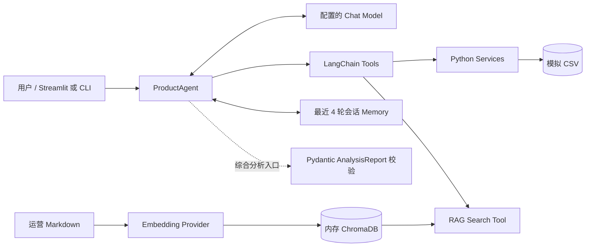

# EcomAgent

一个面向 AI Agent / RAG 工程实践的电商商品分析作品。用户可以用自然语言询问商品、销售、库存和评价问题；Agent 根据问题选择确定性 CSV 分析工具或运营知识检索工具，并基于工具返回生成回答。项目数据全部为可复现的模拟数据，不包含真实商家或客户记录。

当前项目包含 Phase 1–9 的核心实现、离线演示，以及 Streamlit Web UI。真实 Qwen Chat、Tool Calling、LocalHash RAG 和 Dashboard 已由用户在本机浏览器验收；Aliyun Embedding 的独立检索评估已完成，Web UI 内的 Aliyun 初始化与查询尚未验收。

## 功能概览

- **自然语言商品分析**：查询商品信息、销售指标、两个周期的销售变化、库存和评价。
- **LangChain Agent + Tool Calling**：5 个业务 Tool 查询 CSV Service，1 个 RAG Tool 检索运营规则。模型决定调用哪个 Tool；业务数字由 Python Service 计算。
- **结构化综合分析**：综合分析入口使用 Pydantic 校验最终 `AnalysisReport`，Tool 负责提供事实，不把业务计算交给模型。
- **RAG 知识检索**：从 4 份 Markdown 运营知识中检索片段，返回来源、章节和文本证据。
- **会话 Memory**：同一进程/浏览器会话最多保留最近 4 轮已完成的用户问题和最终回答；不持久化 Tool 消息或旧业务数据。
- **Streamlit UI**：AI Chat 展示实际 Agent 回答、状态、模型调用数、Tool 轨迹和 RAG 证据；Dashboard 展示库存、销售、评价指标与趋势图。
- **离线演示与测试**：Fake Model 用于展示和测试 Agent 控制流程，不冒充真实模型回答质量。

## 技术栈与架构

| 部分 | 技术 |
| --- | --- |
| 运行时 | Python 3.10+（开发验证环境：Python 3.12.10） |
| Agent 与工具协议 | LangChain Core、LangChain OpenAI、Pydantic |
| 业务数据 | Pandas、4 份本地 CSV |
| RAG | Markdown Text Splitters、Embedding Provider、ChromaDB、Retriever |
| Web UI | Streamlit 原生组件与图表 |
| 测试 | Python `unittest`、Fake/Mock Model |

系统架构和数据边界详见[架构图与说明](docs/architecture.md)。主要数据流如下：



### Agent Tool Calling 流程

1. Agent 将系统提示、会话中最近的完整对话和当前问题发给配置的 Chat Model。
2. 模型可以返回最终文本，也可以返回已注册 Tool 的名称和结构化参数。
3. Agent 校验 Tool 调用，再将请求分发给对应 LangChain Tool。
4. 业务 Tool 调用 Pandas Service 查询 CSV；知识 Tool 调用 Retriever 检索 Markdown 片段。
5. Agent 把真实 Tool 返回放回模型上下文，循环至得到最终答案或达到调用上限。
6. UI 展示 `AgentResult` 中实际返回的状态、模型调用数、Tool 参数与结果；不会推测或伪造调用轨迹。

业务事实来自本轮 Tool 查询。Memory 仅帮助理解上下文指代，不作为旧库存、销量或评价的事实来源。循环和 Tool 调用都有上限；失败轮次不会写入 Memory。

### RAG Pipeline 与 Embedding 选项

运营 Markdown 经章节保留切分后生成文本块；Embedding Provider 编码文本并写入当前进程的 Chroma collection，Retriever 按相似度返回片段及 source/section 元数据。Chroma 索引在内存中，不跨进程持久化。

| Provider | 维度 | 用途与边界 |
| --- | ---: | --- |
| `LocalHashEmbeddings` | 384 | 确定性字符 n-gram 哈希基线；默认离线运行，不需 API Key 或模型下载。它不是语义 Embedding 模型。 |
| 阿里云百炼 `text-embedding-v4` | 1024 | 北京地域 OpenAI 兼容 Embedding 接口；需单独配置 Embedding Key/Base URL，真实请求可能产生费用。 |

两种 Provider 使用不同维度和隔离的 Chroma collection。CLI 默认 LocalHash；只有显式设置 `EMBEDDING_PROVIDER=aliyun` 才启用云端 Embedding。Web UI 默认 LocalHash，选择 Aliyun 后还需用户确认初始化。配置变量见 [.env.example](.env.example)。

Phase 8 的固定 C07–C09 检索对照中，LocalHash 的 Mean Recall@3 为 1.0、Mean MRR 为 0.7778；百炼的 Mean Recall@3 和 Mean MRR 均为 1.0（3 个固定案例）。C08 的正确来源由 LocalHash 第 3 位升至百炼第 1 位，但 Top-3 片段仍不足以明确支持具体优先处理措施。该小规模评估不代表普遍检索质量，也不验证完整 LLM Agent 问答链路。结果见[Phase 8 检索记录](docs/phase8_retrieval_live_results.json)。

### Streamlit Web UI

运行 [streamlit_app.py](streamlit_app.py) 可打开 AI Chat 与 Dashboard 两个 Tab：

- AI Chat 复用真实 `ProductAgent`、ConversationMemory、业务 Tools 和 RAG Tool；显示实际回答、调用状态、Tool 记录及检索证据。
- Dashboard 复用 CSV Store 与现有 Service，支持 SKU、日期区间选择，展示库存、销售、评价指标和趋势图。
- Qwen Chat API Key 由本机 Python 服务读取，不发送给浏览器端。每轮 Chat 可能产生模型费用。
- Aliyun Embedding 索引只会在页面明确确认后初始化；索引和 Memory 缓存在当前会话。该 Web UI 的真实 Aliyun 初始化和查询**尚未验收**。

## 安装与运行

### 离线安装与演示

需要 Python 3.10 或以上版本。离线 Demo 和测试无需 API Key。

```bash
python3 -m venv .venv
source .venv/bin/activate
python -m pip install -r requirements.txt
python -m scripts.validate_mock_data
python -m scripts.demo_phase9
python -m unittest discover -s tests -v
```

Windows 虚拟环境激活命令为 `.venv\Scripts\activate`；激活后可使用相同的 `python -m ...` 命令。Phase 9 Demo 使用 Fake Model、LocalHash、真实本地 CSV Service 和 RAG；固定回答只展示 Agent 控制流，不代表 LLM 回答质量。

PowerShell 创建和激活环境的示例：

```powershell
py -m venv .venv
.\.venv\Scripts\Activate.ps1
python -m pip install -r requirements.txt
```

### 配置真实 Chat API

复制 [.env.example](.env.example) 为 `.env`，在本机填写 `LLM_API_KEY`、`LLM_BASE_URL` 和 `LLM_MODEL`。macOS/Linux 可执行 `cp .env.example .env`；Windows PowerShell 可执行 `Copy-Item .env.example .env`。不要把真实 Key 放在命令行、README 或 Git 中。首次运行 CLI 的真实 Agent 命令会请求配置的兼容 Chat API：

```bash
python -m scripts.run_agent "SKU003现在有多少库存？" --show-tools
python -m scripts.run_agent --interactive
```

运行综合分析可使用 `scripts.run_analysis`。当前数据固定截止于 2026-09-22，和电脑当天日期无关。

### 启动 Streamlit

Streamlit 是可选直接依赖，核心 CLI 不需要安装它。

```bash
python -m pip install -r requirements-ui.txt
python -m streamlit run streamlit_app.py --server.address 127.0.0.1 --server.port 8501
```

打开本机 `http://127.0.0.1:8501`。发送 Chat 问题会调用真实 Chat Model；LocalHash 不调用 Embedding API。选择 Aliyun 并确认后会初始化云端向量索引，可能产生费用。CLI 云端检索评估同样会调用真实 Embedding API，需先正确配置并明确确认后再运行。

## 测试与已验证结果

```bash
python -m unittest discover -s tests -v
python -m scripts.check_secrets
git diff --check
```

- **离线自动化测试：150 项通过。** 使用 Fake/Mock 验证 Agent Loop、工具、Service、RAG、Memory、配置、安全和 Streamlit 页面行为；不代表真实模型的回答质量。完整测试命令如上。
- **用户浏览器验收：** 真实 Qwen Agent 成功回答 SKU003 库存问题；`get_inventory_data` 返回与展示一致的真实业务数据；第二轮追问能够结合 SKU003 上下文；LocalHash RAG 检索工具返回 success；输入框可连续使用；Dashboard 指标和图表能随 SKU 切换更新。SKU003 期末库存为 50、估算可售约 0.65 天。
- **真实 Embedding 检索评估：** 用户在 Phase 8 的 Mac Terminal 完成 LocalHash 与 `text-embedding-v4` 的 C07–C09 对照。此项评估验证 Embedding → Chroma → Retriever 检索，不等于完整 Qwen Agent 评估。
- **尚未验证：** Streamlit Web UI 内 Aliyun 的真实索引初始化和查询；更广泛的线上检索质量、完整 Agent 回答基准；不同机器上的全传递依赖锁定复现。

## 数据与功能边界

- 数据集包含 15 个模拟 SKU、180 天 CSV；使用固定随机种子和截止日，适合教学与回归测试，不代表真实电商规律或客户数据。
- Service 只覆盖商品、销售、库存和评价；不含广告、订单级客户身份、真实预测或补货流水。
- RAG 只检索当前 Markdown 知识库；当前 C07–C09 评估规模较小，C08 的证据充分性有限。
- Memory 是会话内临时上下文，不写入数据库；Chroma 也是内存索引。
- 不使用 LangGraph、数据库、Redis、FastAPI 或独立前端框架。

## Codex 工程化协作

本仓库包含 [AGENTS.md](AGENTS.md) 和项目级 [ecomagent-phase-workflow Skill](.codex/skills/ecomagent-phase-workflow/SKILL.md)。它们规定 Codex 如何按授权范围开展阶段工作：先检查必要上下文、复用稳定模块、执行离线测试、保护密钥、记录阶段限制，并在 Commit 或进入下一阶段前等待用户明确确认。它们是开发协作说明，不是应用运行依赖。

## 依赖说明

`requirements.txt` 固定核心直接依赖；`requirements-ui.txt` 固定可选 Streamlit 依赖。依赖版本已固定，但当前仓库没有完整的传递依赖锁文件；不同时间安装可能解析到不同的传递依赖版本。
