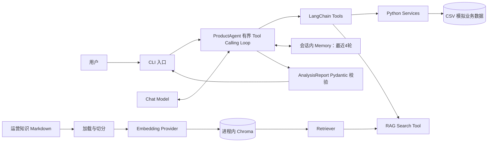

# EcomAgent 系统架构

## 组件关系

## 一次普通问答的数据流

1. CLI 创建 CSV 数据快照、工具和 Agent；交互模式还会创建一个只存在于当前进程的 `ConversationMemory`。
2. `ProductAgent` 将系统提示词、最多4轮已完成的 user/assistant 文本和当前问题交给 Chat Model。
3. 模型可选择已注册工具。Tool 按 schema 校验参数，并调用确定性的 Python Service；业务事实始终来自本轮查询。
4. 对运营规则的问题，RAG Tool 将查询送给 Retriever。知识 Markdown 经分段后由明确配置的 Embedding Provider 编码，向量保存在本次构建的内存 Chroma collection 中。
5. Tool 返回结果给 Agent，Agent 将其交回模型。循环有模型调用和工具调用上限。
6. 普通问答返回可见文本；综合分析额外将最终 JSON 解析为 `AnalysisReport`。只有成功完成的一轮才进入 Memory，失败轮次和 Tool 往返不会进入历史。

## 关键职责边界

| 层 | 负责内容 | 不负责内容 |
| --- | --- | --- |
| Agent | 消息流程、工具调度、有限重试/停止、最终结果协议 | 业务指标计算 |
| Tool | 模型可见的名称、描述、参数校验与结果封装 | 复制业务计算或凭空补数据 |
| Service | Pandas 数据查询、指标与数据质量信息 | 调用 LLM |
| RAG | 运营 Markdown 加载、切分、向量检索 | 业务 CSV 事实查询 |
| Memory | 同一会话最近4轮完整文本 | 持久化或缓存旧工具结果 |
| Structured Output | 校验最终分析结构 | 替代工具证据或完成计算 |

Embedding 默认是完全离线的 `LocalHashEmbeddings`（384维）。只有显式设置 `EMBEDDING_PROVIDER=aliyun` 才使用百炼 `text-embedding-v4`（1024维）；两种向量进入不同的 Chroma collection。Phase 8 已验证真实云端 Embedding/RAG 检索对照，但没有在该验收中调用 Qwen Chat 或验证完整云端 Agent 问答链路。

## 离线与真实边界

- `scripts.demo_phase9` 显式注入 LocalHash 与脚本化 Fake Model，展示真实本地 Tools、RAG 和 Agent 消息循环，不依赖 `.env`。
- Phase 8 的 C07–C09 云端检索结果是用户在 Mac Terminal 的真实执行结果，见 [Phase 8 结果](phase8_retrieval_live_results.json)。三个固定 query 不代表普遍检索质量。
- 完整 Agent + Qwen Chat 的真实云端问答质量应与 Embedding 检索结果分开描述。
